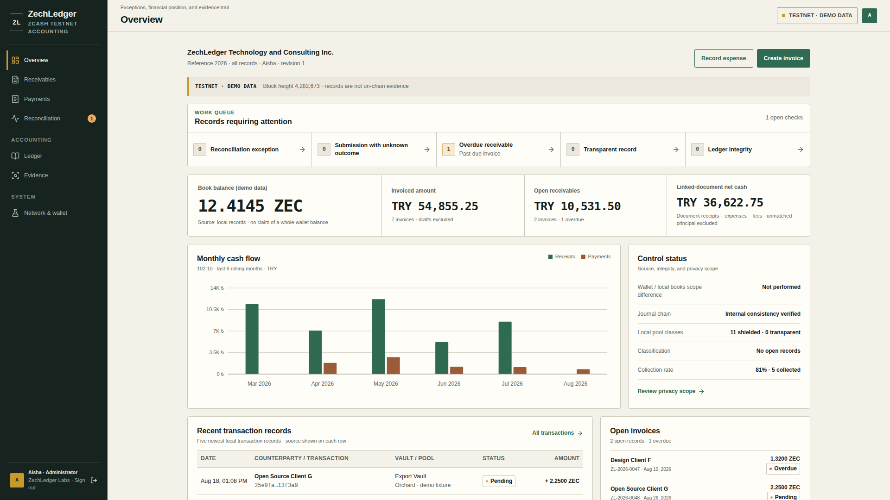

<div align="center">
  
  <h1>ZechLedger</h1>
  <p><b>Privacy-preserving collections, double-entry accounting, and signed scope audits on Zcash Testnet.</b></p>
</div>

> **TESTNET ONLY · NO REAL VALUE** — Mainnet sends are rejected at the code level. TAZ/test ZEC has no economic value.



## What does it offer?

- **ZIP-321 collections:** Binds an immutable, checksum/ZIP-316-validated testnet recipient address, an integer zatoshi amount, and a PII-free opaque memo to each invoice.
- **Exact reconciliation:** Automatic settlement requires the direction, canonical Zallet account, purpose vault, full memo, integer amount, and complete observed recipient address to match. There is no amount-only or substring matching.
- **Expense outbox:** The recipient, amount, and memo in an approved record's metadata cannot be changed. If an RPC result is ambiguous, resending is blocked and the outcome is reconciled through a wallet scan.
- **Double-entry ledger:** Persistent financial fields use integer zatoshi and TRY minor units. Safe-integer/finiteness, debit=credit, and SHA-256 hash-chain invariants are verified before and after every write.
- **Reorg safety:** In complete, synchronized Zallet history, collections, expenses, internal transfers, fees, and anchors are reversed after an observation is absent from two distinct, fixed wallet-tip snapshots. Repeated sync clicks at the same tip do not advance the counter.
- **Purpose vaults:** Actual isolation is provided only by an allowlisted mapping to separate Zallet account UUIDs. A UI vault alone is not a claim of cryptographic isolation.
- **Signed audit capsule:** Contains scope JSON, recomputable record-metadata commitments, and an Ed25519 signature. An optional anchor also produces a signed **wallet observation receipt** that binds the txid, height, and confirmations.
- **Current Zcash stack:** The primary path is Zebra + Zallet/Z3; Sapling, Orchard, and Ironwood are normalized. The end-of-support `zcashd` integration is status/read-only compatibility only; transaction import, settlement, and capsule evidence are disabled.

## Secure quick start

Requirements: Node.js 22 (`.nvmrc`: 22.23.2), npm 10, and `openssl`.

```bash
npm ci
export ZECHLEDGER_ADMIN_TOKEN="$(openssl rand -hex 32)"
echo "Login token: $ZECHLEDGER_ADMIN_TOKEN"
npm run dev
# http://127.0.0.1:3000
```

Enter the generated token on the browser login screen. APIs are disabled by default; without a token, even the health endpoint fails closed with `503`.

For presentations to the judges and screen recordings, use the production build instead of the development toolbar:

```bash
export ZECHLEDGER_ADMIN_TOKEN="$(openssl rand -hex 32)"
npm run build
npm run start
```

To deliberately opt out during a one-time presentation that is completely isolated from the internet:

```bash
ZECHLEDGER_UNSAFE_DEMO_NO_AUTH=true npm run dev
```

This flag is accepted only when `NODE_ENV!=production`, the Host is loopback, no wallet RPC is configured, and `ZCASH_ALLOW_SEND!=true`; `npm run dev` also binds to 127.0.0.1. An existing live ledger will not open under the opt-out. Cross-origin mutations are rejected even in opt-out mode.

### Docker demo

```bash
cat > .env.demo <<EOF
ZECHLEDGER_ADMIN_TOKEN=$(openssl rand -hex 32)
ZECHLEDGER_COOKIE_SECURE=false
EOF
cat .env.demo
docker compose --env-file .env.demo up --build
# binds only to 127.0.0.1:3000
```

### Vercel Blob demo

For a private, authenticated presentation deployment on Vercel, the demo ledger can use a private Blob object instead of the ephemeral filesystem. Configure `BLOB_READ_WRITE_TOKEN`, `ZECHLEDGER_ADMIN_TOKEN`, `ZECHLEDGER_COOKIE_SECURE=true`, and `ZECHLEDGER_VERCEL_BLOB_DEMO=true` in the Vercel project. `ZECHLEDGER_VERCEL_BLOB_STATE_PATH` may override the default `zechledger-demo/ledger.json` object key.

This mode is accepted only in production when wallet RPC is absent and both send/broadcast gates are closed. It is for synthetic presentation data, not live accounting. Serverless audit keys can be supplied as base64 PEM with `ZECHLEDGER_AUDIT_PRIVATE_KEY_B64`; the public key is derived automatically, or an optional matching `ZECHLEDGER_AUDIT_PUBLIC_KEY_B64` can be provided.

### Demo data disclosure

When no wallet URL is configured, synthetic records generated according to the run date are loaded and clearly identified as **presentation fixtures**; only the network height from the rate-limited public testnet Zebra gateway is real. Demo addresses are checksum-valid test vectors, but they do not belong to you and must not be funded.

On the **first** launch with a wallet configured, a separate empty live ledger is created; demo invoices, expenses, journals, and transactions are never mixed into the live ledger. An existing demo ledger is not silently converted to live mode.

## Z3 testnet setup

After `zcashd` v6.20.0 reached end of support, the recommended path for the current Ironwood testnet is:

```text
Zebra (consensus/node) ── RPC ── Zallet (wallet/decrypt/sign)
```

Resources:

- [Official Z3 repository](https://github.com/ZcashFoundation/z3)
- Supported Z3 revision: [`e84ce9fd8e864ff0b2a8a62f6ce14392145db0fb`](https://github.com/ZcashFoundation/z3/commit/e84ce9fd8e864ff0b2a8a62f6ce14392145db0fb)
- [Z3 wallet FAQ](https://github.com/ZcashFoundation/z3/blob/main/docs/faq.md#q-how-do-i-set-up-the-zallet-wallet-on-mainnet-or-testnet)
- [Zallet RPC differences](https://github.com/zcash/zallet/blob/main/book/src/zcashd/json_rpc.md)
- [`zcashd` deprecation](https://z.cash/support/zcashd-deprecation/)

The initial testnet sync is about 30 GB and can take hours. Sync and fund the testnet wallet used for judging in advance.

```bash
npm run z3:setup
npm run z3:start
npm run z3:status
```

Example account and address creation with upstream Z3:

```bash
cd ../z3
zrpc(){ docker compose --env-file .env.testnet exec -T zallet \
  /usr/local/bin/zallet-zaino --datadir /var/lib/zallet \
  --config /etc/zallet/zallet.toml rpc "$@"; }

ACCOUNT=$(zrpc z_getnewaccount '"jury"' | jq -r .account_uuid)
UA=$(zrpc z_getaddressforaccount "\"$ACCOUNT\"" '["orchard","sapling"]' | jq -r .address)
printf 'ACCOUNT=%s\nUA=%s\n' "$ACCOUNT" "$UA"
```

Never put a seed or mnemonic in `.env`, shell history, the repository, or ZechLedger.

## Live mode: required configuration

Use a new directory for a schema 2 live ledger; archive the old demo/schema-1 file:

```bash
cp .env.example .env.local
```

Minimum single-account example:

```dotenv
ZECHLEDGER_ADMIN_TOKEN=<openssl-rand-hex-32>
ZECHLEDGER_COOKIE_SECURE=false
ZECHLEDGER_DATA_DIR=.zechledger-live

ZECHLEDGER_COMPANY_NAME=Example Technology
ZECHLEDGER_COMPANY_LEGAL_NAME=Example Technology Inc.
ZECHLEDGER_COMPANY_TAX_ID=TESTNET-ONLY-123
ZECHLEDGER_OPERATOR_NAME=Demo Operator
ZECHLEDGER_FISCAL_PERIOD=2026
ZECHLEDGER_VAULT_METADATA_MAP={"vault-export":{"name":"Export Collections","purpose":"Testnet export collections","period":"2026","budgetTryKurus":220000000}}

ZEBRA_RPC_URL=http://127.0.0.1:18232
# ZEBRA_COOKIE_PATH=/actual/z3-cookie/.cookie
ZALLET_RPC_URL=http://127.0.0.1:40232
ZALLET_ACCOUNT_UUID=<canonical-account-uuid>
ZCASH_RECEIVER_ADDRESS=<wallet-owned-utest1-or-ztestsapling1>
ZCASH_FROM_ADDRESS=<same-wallet-owned-address>

ZCASH_ALLOW_SEND=false
# After manually verifying that Zallet has [external] broadcast=true:
ZALLET_EXTERNAL_BROADCAST_CONFIRMED=false
ZCASH_MIN_CONFIRMATIONS=10
ZCASH_PRIVACY_POLICY=FullPrivacy
ZALLET_SYNC_MAX_ROWS=5000
ZECHLEDGER_DEMO_RATE_TRY=2950
```

The Compose app service passes documented runtime variables—including `ZALLET_SYNC_MAX_ROWS`, RPC timeout and credential fields, the company logo mark, and audit key paths—into the container through an explicit allowlist. If custom audit key paths are used, they must be under the persistent `/data` directory inside the container.

The live company identity is bound to the ledger with an immutable fingerprint. If the legal name or tax ID changes while financial history exists, the application requires a new data directory. An invoice also snapshots the issuer identity at the time it is issued.

Purpose metadata is fingerprinted as well; the name, purpose, or period of a vault ID cannot be changed while history exists. A new purpose requires a new vault ID or data directory. A budget is **reference metadata** only, not a spending limit.

### Multi-account purpose vaults

`ZALLET_VAULT_ACCOUNT_MAP` maps `account UUID → vault ID`. When using multiple accounts, `ZALLET_ACCOUNT_UUID` must be **empty**:

```dotenv
ZALLET_ACCOUNT_UUID=
ZALLET_VAULT_ACCOUNT_MAP={"uuid-a":"vault-export","uuid-b":"vault-operations","uuid-c":"vault-rnd"}
ZCASH_VAULT_ADDRESS_MAP={"vault-export":"utest1...","vault-operations":"utest1...","vault-rnd":"utest1..."}
ZECHLEDGER_VAULT_METADATA_MAP={"vault-export":{"name":"Export","purpose":"Collections","period":"2026","budgetTryKurus":220000000},"vault-operations":{"name":"Operations","purpose":"Operating expenses","period":"2026","budgetTryKurus":115000000},"vault-rnd":{"name":"R&D","purpose":"R&D expenses","period":"2026","budgetTryKurus":88000000}}
```

ZechLedger does not use `z_listtransactions(null,…)`: it paginates each allowlisted account separately and totals balances only from those accounts with `z_getbalanceforaccount`. Unmapped or personal Zallet accounts are not included in API state.

Optional real UFVK fingerprint:

```dotenv
ZCASH_VAULT_UFVK_MAP={"vault-export":"uviewtest1..."}
```

The UFVK is validated in ZIP-316/F4Jumble format, and only its SHA-256 fingerprint enters state and the capsule; the UFVK itself does not. If an auditor needs actual viewing authority, share the key over a separate trusted channel.

### RPC check

`check:rpc` loads `.env.local` with the Next env loader and requires a wallet by default:

```bash
npm run check:rpc
# Deliberate check for public/configured Zebra only:
npm run check:rpc -- --node-only
```

Missing wallet configuration is not treated as success. If a cookie path is configured, the cookie is actually read. Zallet v0.1.0-beta.1 writes the cookie to `.cookie` in its data directory (standard container path: `/var/lib/zallet/.cookie`); ZechLedger should receive only a read-only `0600` host copy or mount. Do not bind Zallet to the internet; use loopback or a private Docker network.

Docker Z3 peer:

```bash
docker compose --env-file .env.local \
  -f compose.yaml -f compose.z3-testnet.yaml up --build
```

## Collection and expense rules

### Invoice

When an invoice is created, the following fields enter the canonical metadata commitment: number, customer/title, issuer identity, dates, canonical ZEC/zatoshi, booked exchange rate, VAT, vault, immutable recipient address, and account fingerprint. This is **not** a hash of an uploaded PDF or e-invoice file.

Sync posts `Dr 102.10 / Cr 120` only when all of the following match:

- direction is `incoming`,
- canonical Zallet account/vault,
- immutable `receiveAddress`,
- the complete memo,
- integer zatoshi amount,
- required confirmation count.

A second identical payment does not settle the receivable twice; it remains for manual review as a duplicate/overpayment. A reorg or orphaned transaction produces a reversing journal entry.

### Expense

An expense record locks the vendor address, source-account fingerprint, amount, and memo commitment. The payment is not settled if the `to_address` observed by Zallet is different.

This prototype has **no maker-checker or second factor**: the "approved" state is explicitly labeled in the UI as a "single-admin payment queue." PCZT/offline approval is the production path. The budget field is a reference, not an enforced limit.

Sending requires all of the following:

- the chain must be exactly `test`/`testnet`,
- `ZCASH_ALLOW_SEND=true`,
- Zallet configuration has `[external] broadcast=true` and operator confirmation `ZALLET_EXTERNAL_BROADCAST_CONFIRMED=true`,
- a ZIP-316/F4Jumble-decoded testnet UA containing a shielded receiver, or a complete 43-byte Sapling address,
- a fully synchronized wallet,
- memo ≤512 UTF-8 bytes,
- privacy policy exactly `FullPrivacy` (Zallet's `AllowRevealed*`/`NoPrivacy` options are rejected fail-closed),
- an exact match with the recorded destination, amount, and memo,
- `fee=null` passed to Zallet for ZIP-317.

The intent is written atomically to the outbox **before** the RPC call. A definitive JSON-RPC rejection before `z_sendmany` produces an opid can safely be marked failed; if a transport or timeout result is ambiguous, the intent remains pending. An asynchronous `failed`/`cancelled` result after an opid has been obtained is **not** a definitive rejection: a prior transaction in a multi-step proposal may have been broadcast. In that case, the intent remains pending/non-retryable with `outcome unknown`. Retry is enabled only after an `expired_unmined` status on the exact wallet record or a definitive pre-opid RPC rejection. Zallet beta `SendResult` yields only a txid or txids; an RPC response alone does not prove that the network accepted the broadcast. Because `external.broadcast=false` can also produce a txid, explicit operator attestation is required. With a multi-`txids[]` result, ZechLedger does not guess the first txid; "operation complete/created" is only an intermediate state. Financial settlement requires an exact wallet-observed canonical output matching the memo, amount, destination, and account.

## Audit capsule and independent verification

### Breaking upgrade: capsule v3 and Istanbul date policy

New capsules sign `zechledger-audit-capsule/3`, `Europe/Istanbul/v1`, exact-sync observation, and expanded scope/identity commitment fields. v2 is not reinterpreted under the same protocol name: the current verifier deliberately rejects v2. Verify an old capsule with the verifier from the ZechLedger commit/tag that produced it and that release's separately retained public key.

If a current schema 2 **live** data directory contains chain/payment journal history derived under UTC, the application fails closed at startup rather than relabeling it as Istanbul-policy history. Before upgrading:

1. Stop the running old instance; do not open the same data directory concurrently with two versions.
2. Create an encrypted, permission-preserving archive of the complete `ZECHLEDGER_DATA_DIR` (JSON state, audit private/public keys, and persistent files other than the lock); record the old source commit/tag and verifier.
3. Retain the old directory as read-only data for historical verification only. For live v3 operation, start with a new, empty `ZECHLEDGER_DATA_DIR` and the explicit `Europe/Istanbul/v1` policy.
4. A legacy pending v2 anchor is not upgraded or rebroadcast automatically; create a v3 capsule with a new requestId and approve it separately.

The capsule contains:

> A demo manifest carries `mode=demo` / `presentation-fixture-no-chain-evidence` and keeps the transaction list empty. The verifier displays this as a visible warning; synthetic 64-hex fixture txids are not signed as chain evidence.

- journal entries for the selected period/vault and their hashes,
- confirmed txids tied to an exact wallet sync within the last 15 minutes, including mined time, observed-as-of time, direction/amount/memo/destination, and account scope,
- recomputable invoice/expense **metadata**, identity, and scope-role commitment payloads,
- related reversal/repost journal entries outside the period, with an explicit `settlement-support` role, for transactions whose current wallet settlement falls within the selected month,
- **posting-period model:** if a chain journal entry remaining in an earlier month no longer has a current confirmed wallet settlement in that month, the earlier month's capsule is rejected fail-closed; the correction/repost month's capsule carries the supporting history,
- ledger-head context,
- optional UFVK fingerprint,
- manifest SHA-256 + Ed25519 signature.

No Merkle inclusion proof or zero-knowledge balance proof is provided for `ledgerHead`. Because the v3 anchor memo is shielded, a public explorer alone cannot read the manifest hash. The "anchored" label represents an Ed25519-signed **wallet observation receipt**; the receipt binds the plan, account, amount, memo, and observed destination when available. Zallet may return `to_address=null` for an internal output; in that case, the signed plan + exact memo + account are used, and the null limitation remains in the receipt. Independent chain-and-memo verification requires a trusted node and UFVK/decryption obtained through a separate channel.

Download the public key from an authenticated owner session:

```bash
export TOKEN='<ZECHLEDGER_ADMIN_TOKEN>'
curl -fsS -H "Authorization: Bearer $TOKEN" \
  http://127.0.0.1:3000/api/audit/public-key > zechledger-audit-public.pem
curl -fsS -H "Authorization: Bearer $TOKEN" \
  http://127.0.0.1:3000/api/audit/<CAPSULE_ID> > capsule.json

npm run verify:capsule -- capsule.json --public-key zechledger-audit-public.pem
```

The auditor should compare the fingerprint with `signingKeyFingerprint` in the capsule over a verbal or organizational channel that is independent of the server. Downloading both the key and capsule from the same potentially compromised server does not establish a trust root on its own.

The private/public Ed25519 keypair is stored by default in `ZECHLEDGER_DATA_DIR/audit-{private,public}.pem` and persists in the Docker volume. The private key is written with `0600` permissions; the public key is derived from the private key and checked for a match. Do not delete these files without a backup and rotation procedure.

## Honest model for Privacy Lens

Privacy Lens is an administrator-side **visual simulation/preview**. `/api/state` returns the complete payload to the owner session; the public/auditor lens's DOM filter is not real RBAC or data minimization. A real auditor should receive only a server-side-scoped, signed capsule. Transparent outputs appear in the public view; shielded outputs are hidden. No fabricated ciphertext is shown.

## Accounting and valuation

```text
Invoice:     Dr 120 / Cr 600 + Cr 391
Collection:  Dr 102.10 / Cr 120
Expense:     Dr 740 + Dr 191 / Cr 320
Payment:     Dr 320 / Cr 102.10
ZIP-317:     Dr 780 / Cr 102.10
```

- ZEC persistence: integer zatoshi (`1 ZEC = 100,000,000 zatoshi`)
- TRY persistence: integer minor units (1/100 lira); exchange-rate conversion uses decimal→BigInt rational arithmetic and rounds positive half-minor-unit ties up. `Number.isSafeInteger` and finiteness are required.
- Exchange rate: `valuationRateTry` + `configured-static` source snapshot on every record/journal entry
- FX calculations and charting/formatting use JavaScript numbers; there is no claim that "floats are never used." Real accounting requires a rational/decimal FX engine.
- The cash-flow chart is derived only from 102.10 journal legs, using payment, fee, and reversal dates.
- Hash-chain v2 also includes the journal ID and number in the canonical hash scope.
- If the chain is corrupt, all mutations and capsule signing stop fail-closed; demo reset is a separate recovery path.

## Access security

- `ZECHLEDGER_ADMIN_TOKEN` is required by default; known placeholder values are rejected.
- Login cookie: HttpOnly, SameSite=Strict, HMAC-signed, with a server-enforced eight-hour expiry.
- Production access must be behind a TLS reverse proxy; Secure cookies are the default for the application and Compose. HSTS must be added at the reverse-proxy layer where TLS is actually terminated (do not rely on build-time Next configuration). A plain localhost Docker demo explicitly sets `ZECHLEDGER_COOKIE_SECURE=false` in `.env.demo`.
- CSP (`frame-ancestors 'none'`, narrow source lists), X-Frame-Options DENY, nosniff, no-referrer, a restrictive Permissions-Policy, and same-origin isolation headers are added to every response. The current CSP permits inline scripts and styles because of Next hydration; a nonce-based CSP is recommended for production hardening.
- Same-origin/CSRF checks on mutating APIs.
- `/api/zcash/status`, state, sync, send, audit, and public-key endpoints are authenticated; only redacted health and login endpoints are public.
- The login rate limiter trusts proxy headers only when `ZECHLEDGER_TRUST_PROXY=true`, and it is bounded.
- Docker uses a loopback bind, read-only root filesystem, non-root runtime, `no-new-privileges`, and persistent `/data`.
- Wallet/RPC credentials never enter the client bundle or API responses.

## API

All financial routes require an owner cookie or `Authorization: Bearer <ZECHLEDGER_ADMIN_TOKEN>`.

| Method | Route                      | Function                                                            |
| ------ | -------------------------- | ------------------------------------------------------------------- |
| GET    | `/api/state`               | Owner ledger, scoped wallet/node status, and reconciliation metrics |
| POST   | `/api/invoices`            | Invoice with immutable recipient/account/issuer commitments         |
| POST   | `/api/expenses`            | Expense/payable with an immutable vendor destination                |
| POST   | `/api/zcash/sync`          | Allowlisted account scan, exact reconciliation, and reorg reversal  |
| POST   | `/api/zcash/send`          | Outbox + safety-gated testnet `z_sendmany`                          |
| GET    | `/api/zcash/operation/:id` | Async opid and complete `txids[]` tracking                          |
| GET    | `/api/zcash/status`        | Protected Zebra/Zallet readiness and allowlisted balance            |
| POST   | `/api/audit`               | Signed scope + optional anchor outbox                               |
| GET    | `/api/audit/:id`           | Capsule download                                                    |
| GET    | `/api/audit/public-key`    | Authenticated Ed25519 public-key export                             |
| GET    | `/api/health`              | Redacted, authentication-configuration-aware container health       |

## Validation

```bash
npm run typecheck
npm run lint
npm test
npm run build
npm audit --omit=dev
```

Production standalone smoke test:

```bash
ZECHLEDGER_ADMIN_TOKEN="$(openssl rand -hex 32)" ZECHLEDGER_COOKIE_SECURE=false npm start
```

```bash
docker compose --env-file .env.demo config --quiet
docker compose --env-file .env.local -f compose.yaml -f compose.z3-testnet.yaml config --quiet
```

Tests cover money/MAX_MONEY, calendar/month boundaries, ZIP-316/F4Jumble, CSV formula injection, journal identity/hash-chain, Infinity/unsafe integers, Zallet Ironwood/change/self-anchor behavior, decimal-string sending, and the mainnet hard lock.

For every push and pull request, `.github/workflows/ci.yml` runs type checking, linting, the Prettier format check, tests, a production build, full and production-only audits, Compose validation, and a separate Docker build. Dependabot checks npm, GitHub Actions, and Docker updates weekly.

## Demo for judges

1. Log in with the token; on the dashboard, show the distinction between the real public/local testnet height and the **presentation fixtures**.
2. Create an invoice and open its immutable testnet recipient, ZIP-321 QR code, and metadata commitment.
3. Make a shielded payment with a previously synchronized and funded Zallet wallet; if it is not confirmed, honestly leave it pending.
4. After sync, show the exact memo/address/account match and balanced journal entry.
5. State that Privacy Lens is an owner-side simulation.
6. Download the capsule and public key separately, then run the complete verifier command shown above.
7. Close with: "We make no claim of a private ZK balance proof, source-PDF hash, real auditor RBAC, or revocable viewing key."

## Known limitations / production path

- File-backed JSON uses temp-file fsync, atomic rename, directory fsync, and an exclusive live-process lock per data directory. A second writer is rejected fail-closed; multiple instances or users require a transactional database and a unique canonical-output constraint.
- Testnet and a static TRY exchange rate do not constitute production accounting.
- There is no maker-checker, enforced budget, PCZT/offline approval, HSM, actual e-invoice/PDF ingestion, or regulatory engine.
- Privacy Lens is an owner simulation; there is no separate auditor identity or endpoint.
- The capsule does not provide a Merkle inclusion proof for the global ledger head or a zero-knowledge solvency/balance proof.
- Zallet beta RPC semantics may change; pin the deployed tag and run an integration test with an actual self-transfer fixture.
- Wallet scope and entity/vault metadata are immutable once history exists; safe changes require a new account, vault, or data directory and a documented opening/closing migration.
- The public gateway provides no SLA and is used only for a read-only demo height.

## Security reporting

Report vulnerabilities privately through a GitHub Security Advisory rather than a public issue. See [`SECURITY.md`](SECURITY.md) for details.

## License

MIT — experiment on testnet. Do not use with real funds.
